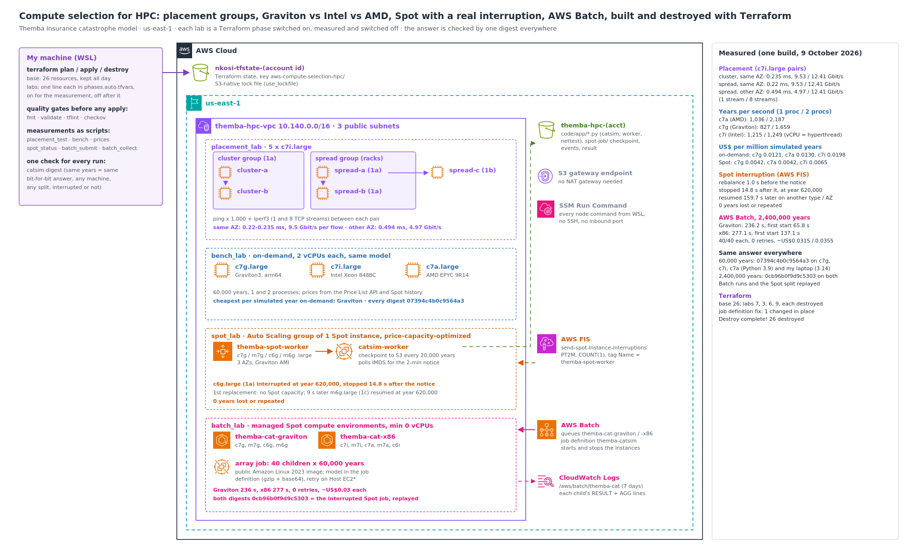

# Compute Selection for HPC: Placement Groups, Graviton vs Intel vs AMD, Spot Interruptions and AWS Batch, Built and Destroyed with Terraform

Themba Insurance is a South African short-term insurer: homes, farms and small businesses, about R104 billion of property insured across 2,000 zones. Every night its catastrophe model simulates hundreds of thousands of possible years of hail, flood and windstorm against that book, and two numbers come out of it that the business can't do without: the average annual loss, which goes into premiums, and the 1-in-200-year loss, which drives the solvency capital the regulator requires. The model ran on one big on-demand x86 server that was on all day and busy for a few hours of it, and on busy nights it wasn't finished by 07:00, when the actuaries and the reinsurance broker need it.

The CFO's question was the one every cloud team gets: can it run faster and cost less? I answered it with measurements instead of opinions. I tested what placement groups actually change between nodes, ran the same model on Graviton, Intel and AMD and priced every simulated year, interrupted a Spot instance for real halfway through a job, and ran the whole night as an AWS Batch array job on Spot, on Graviton and on x86.

One rule held all of it together: **the answer must not depend on the machine.** I built the model so that the same years always give the bit-for-bit same result, summarised in a 16-character digest, whatever the processor, the number of processes, the split into Batch jobs, or an interruption halfway through.

**Every resource was declared in Terraform.** A 26-resource base stayed up all day; each lab was one line in a variables file, switched on for its measurement and off straight after, so only one lab billed at a time; and one `destroy` removed the rest.

**Headline results**

| | Result | What it proves |
|---|---|---|
| **Placement** (c7i.large pairs) | Cluster group, same AZ: **0.235 ms** round trip, **9.53 Gbit/s** on one TCP stream. Spread group, same AZ: **0.22 ms**, **9.53 Gbit/s**. Spread group, other AZ: **0.494 ms**, **4.97 Gbit/s**. All three **12.41 Gbit/s** with 8 streams | At this instance size the AZ boundary mattered and the cluster group didn't: crossing AZs doubled latency and halved a single flow, while the instance's own bandwidth cap was the same everywhere |
| **Graviton vs Intel vs AMD** | Years per second with 2 vCPUs: AMD c7a **2,187**, Graviton c7g **1,659**, Intel c7i **1,249**. US$ per million simulated years on-demand: **c7g 0.0121**, c7a 0.0130, c7i 0.0198; on Spot: c7g and c7a **0.0042**, c7i 0.0065 | Graviton is the slowest per core and the cheapest per unit of work on-demand. Intel's second vCPU added **3%** (a hyperthread, not a core); Graviton's and AMD's doubled the speed |
| **Spot, interrupted for real** | AWS FIS sent the interruption: the worker saw the rebalance recommendation, then the 2-minute notice **1 s** later, and stopped at a checkpoint **14.8 s** after it, at year **620,000**. The first replacement launch failed (**no Spot capacity**); **9 s** later the group launched another type in another AZ, which resumed **at year 620,000** | Checkpoint + notice handling + a diversified Auto Scaling group: **0 years lost or repeated** |
| **AWS Batch on Spot** | 2,400,000 years as **40 children × 60,000**: Graviton **236.2 s** (first start after 65.8 s), x86 **277.1 s** (137.1 s); **40/40** each, **0 retries**, about **US$0.03** each; Batch scaled back to zero by itself | The night run fits in under 5 minutes of wall clock, paying only while it runs |
| **Same answer everywhere** | 60,000 years: **`07394c4b0c9564a3`** on c7g, c7i and c7a (1 and 2 processes) and on my laptop. 2,400,000 years: **`0cb96b0f9d9c5303`** from both Batch runs and from the Spot job's split at its interruption point (years 0–619,999 + 620,000–2,399,999), replayed | Moving the model between processors, splitting it 40 ways or interrupting it doesn't change the result, so the cheapest compute can be chosen freely |

- **Terraform:** base `Plan: 26 to add`; labs `7`, `3`, `6` and `9` to add, each destroyed again after its measurement; a fix to the Batch job definition `1 to change` in place; **`Destroy complete! Resources: 26 destroyed.`** and an empty state.
- **No inbound access to any node** (SSM only, security group open only to itself), IMDSv2 required and encrypted volumes on the nodes I launch, a TLS-only bucket, and an FIS role that can only interrupt instances tagged `themba-spot-worker`.



---

## Why this project is Terraform

Apart from `aws-terraform-iac-pipeline`, I built my earlier environments from the AWS CLI, chaining commands into long sequences to save time. Most of those chains were the same work every time, and I got tired of writing and re-running long, repetitive command chains; every manual teardown also risked one forgotten delete left billing. Since `aws-dynamodb-data-modeling` the infrastructure is code. Here it also made the lab-by-lab approach cheap: each lab is a `count` or `for_each` behind one variable, so switching it on and off is one line and one `apply`, and the destroy covers whatever was left. Details: [`docs/terraform.md`](docs/terraform.md).

---

## The problem I was solving

> Choose the compute for an HPC-style batch workload from measurements: what placement does to the network between nodes, which processor gives the most work per dollar, whether Spot's interruptions can be survived without losing work, and how the nightly run looks as an elastic AWS Batch job, without the answer depending on any of those choices.

---

## Four ideas the whole build depends on

1. **Price per unit of work, not price per hour or speed.** The fastest instance (AMD, here) and the cheapest per hour (Graviton) are different questions from the one that matters: dollars per million simulated years.
2. **A vCPU isn't the same thing everywhere.** On c7i, two vCPUs are one physical core with hyperthreading; on c7g and c7a they're two cores. For a compute-bound model that's the difference between a 1.03× and a 2× speed-up.
3. **Spot is safe for work that can stop and resume.** Save progress somewhere that outlives the instance, notice the 2-minute warning, and let something launch a replacement from more than one Spot pool.
4. **Make the answer independent of the machine, then check it.** Each simulated year has its own random seed and the model only uses arithmetic IEEE 754 defines exactly, so every run of the same years can be compared with one digest.

---

## Architecture decisions

| ADR | Decision |
|---|---|
| [0001](docs/adr/0001-deterministic-model-checked-by-digest.md) | A deterministic model, split by year, checked by one digest on every run |
| [0002](docs/adr/0002-no-cluster-placement-group-for-this-workload.md) | No cluster placement group for this workload; keep nodes in one AZ when they talk to each other |
| [0003](docs/adr/0003-graviton-first-x86-as-fallback.md) | Graviton first for the night run, x86 as a fallback queue |
| [0004](docs/adr/0004-spot-with-checkpoints-and-diversified-pools.md) | Spot with checkpoints to S3, notice handling, and an Auto Scaling group over 4 types and 3 AZs |
| [0005](docs/adr/0005-aws-batch-array-jobs-on-managed-spot.md) | AWS Batch array jobs on managed Spot compute environments that scale to zero |
| [0006](docs/adr/0006-terraform-labs-as-phase-switches.md) | Terraform with the shared state bucket, each lab a phase switch |

---

## How I built and measured it

1. **Before the first apply:** checked the shared state bucket, which AZs offered all three benchmark types (five did, including the three used here), and the account's vCPU quotas (16 on-demand, 32 Spot).
2. **Quality gates:** `terraform fmt -check`, `validate`, `tflint`, all clean; `checkov` **74 passed, 19 failed**, triaged in [`docs/terraform.md`](docs/terraform.md).
3. **Base:** `Plan: 26 to add` (VPC, three public subnets, S3 gateway endpoint, a security group open only to itself, the bucket with the tool code, the node role). State list 29.
4. **The model, on my laptop first:** 4,000 years in one run and as two merged halves: the same digest, `78a9364c876e456c`. See [`docs/the-model.md`](docs/the-model.md).
5. **Placement lab** (`placement_lab = true`, 7 resources): two placement groups and five c7i.large nodes; ping and iperf3 between three pairs; lab off. See [`docs/placement.md`](docs/placement.md).
6. **Processor lab** (`bench_lab = true`, 3 resources): c7g, c7i, c7a; the same 60,000 years with 1 and 2 processes; today's on-demand and Spot prices; lab off. See [`docs/processors.md`](docs/processors.md).
7. **Spot lab** (`spot_lab = true`, 6 resources): the checkpointing worker in an Auto Scaling group of one, and an AWS FIS experiment that interrupted it; lab off. See [`docs/spot.md`](docs/spot.md).
8. **Batch lab** (`batch_lab = true`, 9 resources): two Spot compute environments and queues; the same 2,400,000 years as a 40-child array job on Graviton, then on x86; lab off. See [`docs/batch.md`](docs/batch.md).
9. **Teardown:** `Destroy complete! Resources: 26 destroyed.`, clean check empty. See [`docs/teardown.md`](docs/teardown.md).

---

## What I proved

**Placement groups weren't the lever at this size; the AZ boundary was.** Between two c7i.large nodes in the same AZ, the round trip was about 0.22–0.235 ms and one TCP stream reached 9.53 Gbit/s, in the cluster group and the spread group alike. Across AZs the round trip doubled (0.494 ms) and a single stream stopped at 4.965 Gbit/s, in line with the 5 Gbit/s per-flow limit AWS documents for traffic outside a cluster placement group (which in my test only showed up between AZs: the same-AZ spread pair wasn't limited). With 8 streams, every pair hit the same 12.41 Gbit/s: the instance's own limit. A cluster group earns its place with larger, network-optimised instances and EFA for tightly coupled MPI work; Themba's model is embarrassingly parallel (no traffic between nodes at all), so it doesn't need one.

**Graviton gives the most work per on-demand dollar; AMD the most per second.** Per core, Intel was fastest (1,215 years/s), AMD next (1,036), Graviton slowest (827). With both vCPUs, AMD and Graviton doubled while Intel gained 3%, because a c7i vCPU is a hyperthread. Priced at today's on-demand rates, Graviton came out cheapest per simulated year (US$0.0121 per million), AMD 7% dearer, Intel about 64% dearer; on Spot, Graviton and AMD tied. Every run on every processor produced the same digest.

**A real Spot interruption cost nothing but time.** The worker checkpointed every 20,000 years (about 17–19 s on a c6g.large). FIS triggered the real sequence: rebalance recommendation, then the 2-minute notice 1 s later. The worker finished the chunk it was in, saved the checkpoint and stopped 14.8 s after the notice, at year 620,000. After AWS took the instance, the Auto Scaling group's first replacement failed for lack of Spot capacity; with four instance types across three AZs to choose from, the next attempt 9 s later got an m6g.large in another AZ, which resumed at exactly year 620,000. The resumed run wasn't left to finish on AWS, so I replayed its arithmetic on my laptop, split at that same year: the merged digest equals both Batch runs'.

**The night run belongs on AWS Batch.** The same 2,400,000 years took 236 s on Graviton Spot and 277 s on x86 Spot, about 4–5 minutes from submit to answer, with 13 children running at once, no retries, and roughly US$0.03 of instance time per run. Batch picked the instances itself (a c7g.4xlarge plus five m6g.large on Graviton; three c7a.large, an m7i.4xlarge and an m7i.xlarge on x86) and scaled to zero afterwards. Graviton's capacity arrived in 66 s, x86's in 137 s; per container x86 was faster, but the queue wait decided the wall clock.

### What the numbers don't say

- **Every result is one run,** on 9 October 2026, and Spot prices change by the hour. The ranking per dollar is what to take away, not the fourth decimal.
- **The benchmark is one workload in one language.** catsim is pure Python; compiled, vectorised code would change the speeds and possibly the ranking. The method (same code, digest check, price per unit of work) is what carries over.
- **The interrupted Spot job's final digest wasn't captured on AWS.** I switched the Spot lab off before the resumed worker finished. The resume point (year 620,000, 0 lost or repeated) is measured on AWS; the final answer for that split is reproduced on my laptop and matches Batch.
- **The cluster group test used 2-vCPU instances.** The finding is about this size; larger, network-optimised instances behave differently, and EFA wasn't tested.
- **Batch costs are estimates:** each instance's lifetime from EC2 × the Spot price at collection time, not the bill.

---

## Debugging along the way

Full list in [`docs/debugging-journey.md`](docs/debugging-journey.md). Some of them:

- **Every Batch child failed in 18 seconds with `Container Overrides length must be at most 8192`.** I'd shipped the model base64-encoded in an environment variable (10,732 characters), and Batch passes the environment to ECS as container overrides. Gzip before base64 brought it to 4,360; one in-place job definition update, and the rerun went 40/40.
- **The Spot replacement's first launch failed for lack of capacity.** Not a bug: the reason the group lists four types in three AZs.
- **A second FIS experiment failed** because the only target had already been interrupted by the first; the completed one is the one that counts.
- **My collect script crashed twice** on Batch's shape: no attempts at all on the failed run, and no `stoppedAt` on a finished array parent. Both are handled now; the wall clock comes from the last child to stop.

---

## Cost

The labs ran on 9 October 2026, between about 12:25 and 13:50 South African time, each switched off right after its measurement. I estimate the build at **about US$0.35–0.45**: on-demand nodes for the placement and processor labs (about US$0.13), FIS (US$0.10–0.20, billed per action-minute; it depends on whether the failed second experiment was billed), Spot for the worker and both Batch runs (under US$0.10), and cents for S3, CloudWatch and public IPv4. Cost Explorer hadn't posted the day when I packaged the repo; [`docs/cost-model.md`](docs/cost-model.md) has the estimate line by line and the business case: the night run at these rates.

---

## Compliance & frameworks

The model's inputs here are synthetic (2,000 generated zones, no policyholder data), so the drivers are change control, resilience and capacity, not privacy.

- **Prudential Authority / FSCA Joint Standard 1 of 2023 (IT Governance and Risk Management)**, the South African standard for insurers' IT: changes made through reviewed Terraform plans, capacity chosen from measured performance, and resilience of a business-critical batch process (checkpoint and resume, retries, diversified capacity).
- **ISO/IEC 27001:2022 Annex A**
  - **A.8.6 Capacity management:** compute sized and selected from measured throughput and price per unit of work.
  - **A.8.9 Configuration management** and **A.8.32 Change management:** infrastructure as code, plans reviewed before apply, every lab built and removed by Terraform.
  - **A.8.14 Redundancy of information processing facilities:** the worker can run on four instance types in three AZs; Batch has an x86 queue beside the Graviton one.
  - **A.8.2 Privileged access rights:** the FIS role can only interrupt instances tagged as the Spot worker; nodes have no inbound access.
- **NIST SP 800-53 Rev. 5:** **CM-2 / CM-3** baseline configuration and change control, **CP-10** recovery and reconstitution (resume from checkpoint), **SC-7** boundary protection (no inbound), **AC-6** least privilege.

---

## Repo layout

```
.
├── README.md
├── bootstrap/main.tf                 # the shared Terraform state bucket (created in aws-dynamodb-data-modeling)
├── infra/                            # this project's Terraform
│   ├── versions.tf                   # Terraform >= 1.11, AWS provider ~> 6.60, S3 backend with use_lockfile
│   ├── variables.tf                  # settings + lab switches (placement_lab, bench_lab, spot_lab, batch_lab)
│   ├── main.tf  network.tf  storage.tf  iam.tf
│   ├── placement.tf  bench.tf  spot.tf  batch.tf  outputs.tf
│   ├── templates/userdata.sh.tftpl   # the nodes' boot script (placement / bench / spot roles)
│   └── .terraform.lock.hcl           # exact provider version used (aws 6.68.0)
├── app/                              # copied to the nodes: catsim.py (the model), worker.py (Spot worker), nettest.py
├── scripts/                          # run from WSL: SSM, placement_test, bench, prices, spot_status, batch_submit/collect, results
├── .tflint.hcl  env.sh.example  .gitignore
└── docs/
    ├── architecture.png / .svg  diagram/       # official AWS icons; build_architecture.py regenerates it
    ├── the-model.md  placement.md  processors.md  spot.md  batch.md
    ├── terraform.md  debugging-journey.md  cost-model.md  teardown.md
    ├── adr/                          # 6 decisions
    ├── results/                      # curated CSVs + raw/ (every saved output, account ID masked)
    ├── screenshots.md                # what each screenshot shows
    └── screenshots/                  # 33, in build order
```

---

## Reproduce it

From WSL, as an administrator, with Terraform >= 1.11, tflint, checkov and Python 3. Everything runs from the repo folder.

1. `cp env.sh.example env.sh && mkdir -p build/results && source ./env.sh`, `save ACCOUNT_ID "$(aws sts get-caller-identity --query Account --output text)"`, `save STATE_BUCKET "nkosi-tfstate-$ACCOUNT_ID"` (or create it with `bootstrap/`).
2. Check the first AZ in `azs` offers c7g/c7i/c7a.large (`aws ec2 describe-instance-type-offerings`) and the vCPU quotas (on-demand ≥ 10; Spot ≥ 26, because Batch launched 26 Spot vCPUs per run; this account had 16 and 32).
3. `terraform -chdir=infra init -backend-config="bucket=$STATE_BUCKET"`, fmt, validate, tflint, checkov; `terraform -chdir=infra apply` (26 to add).
4. `python3 app/catsim.py run --years 4000 --procs 1` and the two-halves merge: same digest.
5. For each lab: add its line to `infra/phases.auto.tfvars`, apply, measure, delete the line, apply.
   - `placement_lab = true` → `python3 scripts/placement_test.py`
   - `bench_lab = true` → `python3 scripts/bench.py --years 60000`
   - `spot_lab = true` → `python3 scripts/spot_status.py`, then `aws fis start-experiment --experiment-template-id "$(terraform -chdir=infra output -raw fis_template_id)"`, then `python3 scripts/spot_status.py --watch 20` until it finishes, then `--final`
   - `batch_lab = true` → `python3 scripts/batch_submit.py --arch graviton --size 40 --years 60000` and `python3 scripts/batch_collect.py --arch graviton`; the same with `--arch x86`
6. `python3 scripts/results.py`, then [`docs/teardown.md`](docs/teardown.md).

---

## What this connects to

- `aws-dynamodb-data-modeling`: the shared Terraform state bucket and the phase-switch pattern.
- `aws-streaming-analytics-lake`: the previous Terraform build, and the same habit of checking an answer by comparing it, not trusting it.
- `aws-private-connectivity-endpoints`: the free S3 gateway endpoint the nodes use for their code and checkpoints.
- `aws-terraform-iac-pipeline`: the remote-state pattern every project now reuses.
- Next: a project-agnostic teardown tool driven by the `Project` tag, which every resource here carries.
